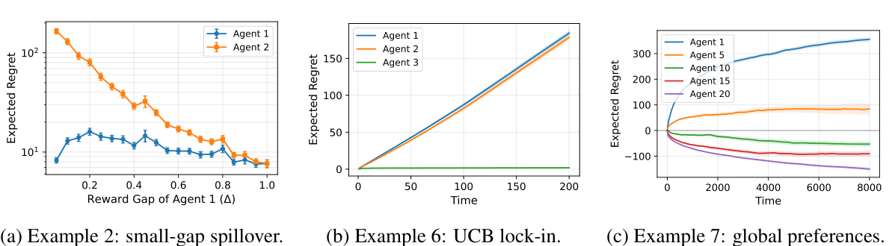
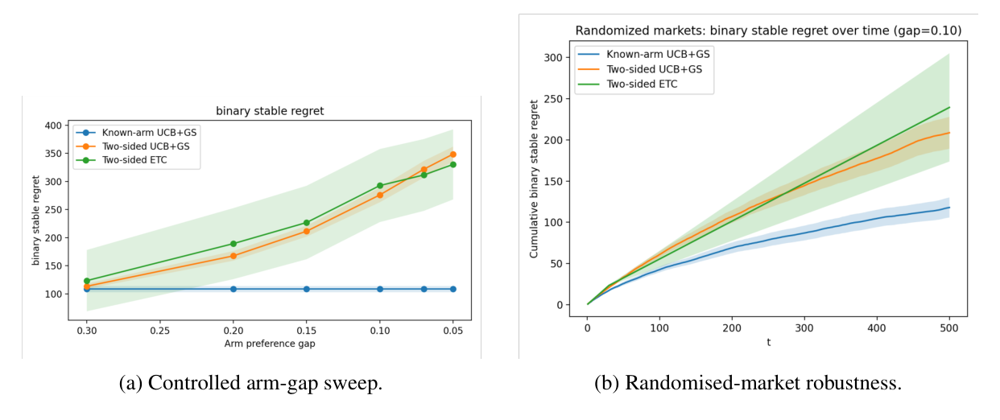
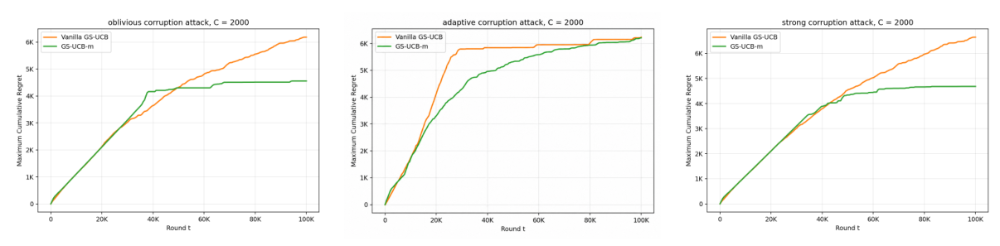

# Centralized Matching Bandits

**Learning stable matchings under uncertainty: regret lower bounds, two-sided preference learning, and robustness to adversarial feedback.**

Research project for *Reinforcement Learning and Decision Making Under Uncertainty*  
University of Bern · University of Neuchâtel

**Authors:** Guodong Ma · Pengcheng Weng · Lishang Xu · Alec Imhof

[**Read the project report**](docs/project_report.pdf) · [Baseline replication](competing_bandit/) · [Two-sided learning](extension2/) · [Robust matching bandits](src/ucb_corruption/)

## Overview

What happens when people (or algorithms) must learn who to match with **while competing for the same partners**?

Consider a job market: applicants learn which employers suit them, employers have their own preferences, and each interaction provides imperfect feedback. A good matching system must balance **exploration** (learning unknown preferences) with **stability** (avoiding pairs who would rather be matched to each other).

This project studies that problem in **centralized matching markets with multi-armed bandit feedback**. We start by reproducing the UCB + Gale–Shapley model of [Liu, Mania & Jordan (2020)](https://arxiv.org/abs/1906.05363), then investigate three questions:

1. **Fundamental limits:** Is regret caused by one agent's exploration unavoidable for other agents?
2. **Two-sided uncertainty:** What changes when both players *and* arms must learn their preferences?
3. **Adversarial robustness:** Can stable matching remain effective when observed rewards are deliberately manipulated?

The project combines **theoretical analysis, Python simulations, algorithm implementation, and empirical evaluation**.

## Research contributions and findings

### 0. Reproducing the baseline

We reimplemented centralized **UCB-GS** (Upper Confidence Bound + agent-proposing Gale–Shapley) and reproduced three experiments from *Competing Bandits in Matching Markets* (Liu et al., 2020):

- **Small-gap spillovers:** Exploration by a high-priority player can create regret for another player.
- **UCB lock-in:** Agent-optimal stable regret can be close to linear in some markets, even when weaker stable-regret guarantees hold.
- **Global preferences:** Lower-priority players may experience negative regret relative to their stable-matching benchmark during exploration.



*Reproduction of the three experiments discussed in Appendix A of the project report.*

### 1. A lower bound on matching-market regret

In a two-player, two-arm Gaussian market, the lower-priority player suffers whenever the higher-priority player explores the wrong arm. By reducing this interaction to a classical Gaussian bandit, we establish an asymptotic lower bound for globally uniformly good algorithms:

$$
\liminf_{T\to\infty}\frac{R_2(T)}{\log T}\geq\frac{2\gamma}{\Delta^2}.
$$

Here, $\Delta$ is the high-priority player's reward gap and $\gamma$ is the regret incurred by the displaced player. We also derive an exact **Explore-Then-Commit (ETC)** expression with leading logarithmic constant $4\gamma/\Delta^2$ — twice the lower-bound constant.

**Takeaway:** The exploration externality is intrinsic to this matching instance, not merely an artifact of the UCB analysis.

### 2. Learning preferences on both sides

The original centralized model assumes the arms' preference rankings are known. We remove that assumption: **players and arms both estimate preferences from noisy observations**.

We compare **known-arm UCB+GS**, **two-sided UCB+GS**, and **two-sided ETC** using *binary stable regret*: the number of rounds in which the matching is unstable with respect to the **true** preferences.



*Left: binary stable regret across arm-side preference gaps. Right: cumulative instability in randomized markets (project report, Figure 1).*

**Takeaway:** As arm-side reward gaps become small, learning stable matchings becomes substantially harder. In our experiments, two-sided methods accumulate much more instability than the known-arm baseline.

### 3. Robust matching under adversarial reward corruption

We introduce three adversary models with **per-player corruption budgets**:

| Adversary | Capabilities |
| --- | --- |
| **Class A — oblivious** | Perturbs a fixed target before matching, without adapting to past observations. |
| **Class B — adaptive online** | Uses historical observations to choose which pre-matching reward to manipulate. |
| **Class C — strong / post-matching** | Observes the matching, then manipulates the reward actually delivered to the learner. |

We compare standard sample-mean **UCB-GS** against **GS-UCB-M**, a robust variant that uses **chronological median-of-means** estimates with an adjusted exploration bonus. GS-UCB-M does **not** require the corruption budget $C$ as an input.



*Illustrative worst-player regret comparisons under all three adversary classes (project report, Figure 3).*

**Takeaway:** Within the evaluated horizons and budgets, GS-UCB-M's regret curves level off as the finite corruption budget is spent. It outperforms vanilla UCB-GS against Classes A and C; against Class B, performance is comparable or sometimes slightly worse. These are **empirical findings**, not a general robustness guarantee.

## How the system works

In the original centralized setting, each round follows the same feedback loop:

```text
1. Players estimate expected rewards and rank the available arms.
2. A central platform runs agent-proposing Gale–Shapley.
3. Each player is matched to one arm and observes that match's reward.
4. Learning algorithms update their estimates from the observed feedback.
5. Repeat; evaluate regret or stability against the true-preference benchmark.
```

The extensions change *what must be learned* (both sides in Extension 2) or *how trustworthy the feedback is* (adversarial corruption in Extension 3).

## Repository guide

This repository grew around separate experiments rather than one monolithic application. The directories correspond to related, but **independently organized**, research components:

```text
.
├── competing_bandit/          # Baseline replication: UCB-GS, simulations, tests, plots
├── extension2/                # Two-sided preference-learning experiments
├── src/ucb_corruption/        # Adversaries, robust estimators, simulation machinery
├── scripts/                   # Supporting scripts / experiment-manifest generation
├── pyproject.toml             # Dependencies for the ucb-corruption Python package
├── README.md
└── docs/                      # Project report and selected figures (README assets)
    ├── project_report.pdf
    └── figures/
```

**Where to start:** Read [`competing_bandit/README.md`](competing_bandit/README.md) for a standalone baseline replication, [`extension2/`](extension2/) for two-sided experiments, or [`src/ucb_corruption/algorithms.py`](src/ucb_corruption/algorithms.py) and [`src/ucb_corruption/adversaries.py`](src/ucb_corruption/adversaries.py) for the robust-learning extension.

## Getting started

**Requirements:** Python 3.10+ and `pip`.

Clone the repository and create a virtual environment:

```bash
git clone https://github.com/inori0cc/rldmuu_seminar_matching_and_bandit.git
cd rldmuu_seminar_matching_and_bandit
python -m venv .venv
```

Activate the environment (`source .venv/bin/activate` on macOS/Linux, or `.venv\Scripts\Activate.ps1` in Windows PowerShell).

### Baseline replication (runnable example)

The replication has its **own** requirements, configs, test suite, and experiment entry points:

```bash
cd competing_bandit
python -m pip install -r requirements.txt

# Run the test suite
python -m pytest tests/ -v

# Quick simulation of Figure 1(a)
python experiments/run_figure_1a.py --config config/figure_1a.yaml --smoke

# Full Figure 1(a) and its plot
python experiments/run_figure_1a.py --config config/figure_1a.yaml
python analysis/plot_figure_1a.py
```

For Figures 1(b) and 1(c), replace `1a` with `1b` or `1c`. See the [replication README](competing_bandit/README.md) for all commands and generated output paths.

### Adversarial-corruption package

From the **repository root** (not `competing_bandit/`), install the packaged corruption experiment code:

```bash
python -m pip install -e ".[dev]"
```

The root-level script below generates a **TSV experiment manifest**; it does not execute the listed simulations:

```bash
python scripts/run_grid.py --tsv runs.tsv
```

**Reproduction note:** This script's default grid is an exploratory configuration and differs from the final corruption experiments in the report. For the report's settings, refer to Section 5 and Appendix C (five-by-five markets, 100,000 rounds, three adversary classes, and budgets from 300 to 3,000). Do not treat the manifest command alone as reproduction of Figure 2 or Figure 3.

## Experimental scope and limitations

| Component | Evaluation | Scope |
| --- | --- | --- |
| Baseline replication | Gaussian rewards; Examples 2, 6, and 7 of Liu et al. | Empirical reproduction of published phenomena |
| Lower bound | Two-player, two-arm Gaussian instance | Analytical result under stated assumptions |
| Two-sided learning | Controlled 3×3 market, arm-gap sweep, randomized markets | Empirical stability comparison |
| Adversarial corruption | 5×5 market, $T=100{,}000$, per-player attack budgets, three seeds | Empirical robustness comparison |

The theoretical guarantee concerns the **specific lower-bound instance**. Extensions 2 and 3 are simulation-based; this work does **not** establish general finite-time regret guarantees for two-sided learning or GS-UCB-M under corruption. The repository is a **research implementation**, not a production matching service.

## Report and references

The full [**Centralized Matching Bandits: Lower Bounds, Two-Sided Learning, and Robustness to Adversarial Corruption**](docs/project_report.pdf) report contains the proof, algorithm definitions, experiment configurations, discussion, and additional figures.

The project builds primarily on:

- **Liu, Mania & Jordan (2020).** *Competing Bandits in Matching Markets.* AISTATS. [arXiv](https://arxiv.org/abs/1906.05363).
- **Gale & Shapley (1962).** *College Admissions and the Stability of Marriage.*
- **Lai & Robbins (1985).** *Asymptotically Efficient Adaptive Allocation Rules.*
- **Wang et al. (2025).** *Stochastic Bandits Robust to Adversarial Attacks.*

Additional literature and full bibliographic details are listed in the project report.

---

**Project team:** Guodong Ma, Pengcheng Weng, Lishang Xu, Alec Imhof  
**Context:** Reinforcement Learning and Decision Making Under Uncertainty — research seminar project, 2026.
